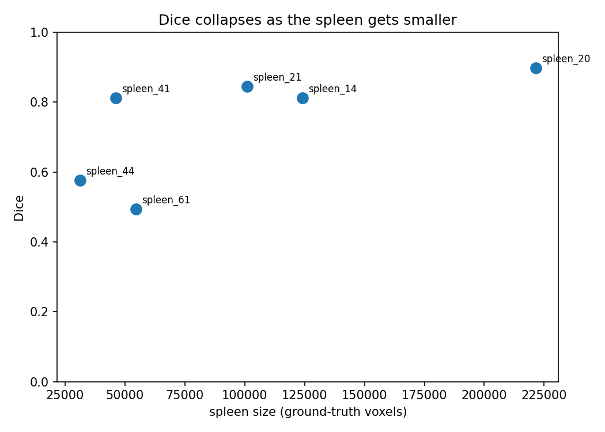
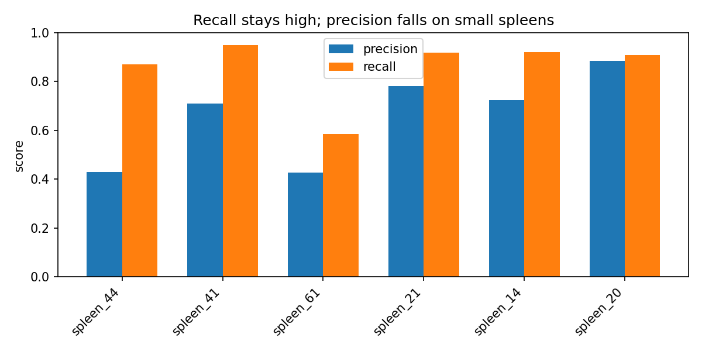

# Spleen Segmentation from CT — 2D U-Net


A 2D U-Net that automatically segments the spleen from abdominal CT scans, built in PyTorch + MONAI on the Medical Segmentation Decathlon spleen task. The focus of this project is **rigorous, honest evaluation and failure analysis** — not a leaderboard number.

**Live demo:** https://spleen-ct-segmentation-pfbly9ra9dnqnhnypuji2a.streamlit.app/

---

## Problem

Manually outlining organs on CT scans, slice by slice, is slow and inconsistent between clinicians. This project automates that for the spleen: given a CT scan, the model outputs a pixel-level mask of the organ, so the spleen can be identified and measured automatically and reproducibly.

**Scope:** this is a proof-of-concept, not a clinical tool. The goal was to build and rigorously evaluate a full segmentation pipeline end to end — not to ship something for clinical use, which would require far more data, external validation across scanners, 3D, and regulatory work.

---

## Results

On a held-out test set of **6 patients** (from 41 total scans), never seen during training or checkpoint selection:

| Metric | Value |
|---|---|
| Mean Dice | 0.739 |
| Median Dice | 0.812 |
| Range | 0.494 – 0.897 |
| Best case | spleen_20 (0.897) |
| Worst case | spleen_61 (0.494) |

The **spread matters more than the mean** — a single average would hide that the model works well on most patients (~0.81–0.90) and fails badly on two (0.49, 0.58). That spread is the subject of the failure analysis below.




---

## Method

- **Dataset:** Medical Segmentation Decathlon, Task09 Spleen — 41 labeled CT volumes.
- **Patient-level split:** 29 train / 6 validation / 6 test, fixed seed 42. Patients are split *before* slices are extracted, so no patient's slices leak across train and test. (Random slice-level splitting inflates scores — this is the detail that makes the numbers trustworthy.)
- **2D pipeline:** extract axial slices, apply CT windowing (level 50, width 350) so soft tissue is visible, resize to 256×256.
- **Model:** MONAI `UNet` (spatial_dims=2, channels 16/32/64/128), Dice loss, Adam (lr 1e-3).
- **Training:** data augmentation (flips, rotations, brightness), 8 background slices per scan added to training, 30 epochs with a cosine LR schedule, best checkpoint selected by validation Dice (best val Dice 0.91).
- **Reproducibility:** all RNG seeded (Python, NumPy, PyTorch, CUDA) and cuDNN set deterministic, so runs are stable rather than drifting between sessions. (GPU ops are not bitwise-identical, but results no longer swing run to run.)
- **Evaluation:** per-case Dice on **full volumes** (including background slices, so false positives on empty slices count), on the held-out test set.

---

## Failure Analysis

**The failure pattern.** The model over-predicts — it labels more voxels as spleen than are really there, on every test case. The amount of over-prediction stays roughly constant in absolute voxels, so on a large spleen it's a minor percentage error (+2.8% on the largest) but on a small spleen that fixed excess is as large as the organ itself (+103% on the smallest) and the Dice collapses. In precision/recall terms: recall stays high across most cases (the model finds the spleen), but precision falls sharply as the spleen shrinks (it also fires on things that aren't spleen). The failure is precision, not recall.

**Root cause.** During training the model saw mostly spleen-containing slices plus only 8 background slices per scan — too few to learn what "empty" looks like. At test time it ran on full volumes, where most slices have no spleen, and it fired on them anyway. It was trained in a world where spleen is almost always present, then tested in one where spleen is mostly absent, so it never learned to stay silent when there's nothing there. The false-positive figures show red predictions on hip, pelvis, and chest slices that contain no spleen at all.

**Two different failures.** spleen_61 and spleen_44 are the two worst cases, but they fail differently. spleen_44 fails through over-prediction alone — recall stays fine (0.87), precision collapses (0.43). spleen_61 is worse: its recall drops to 0.585, meaning it also misses ~42% of the real spleen — so it both over-predicts on empty areas and under-segments the actual organ. One honest nuance: size correlates with performance but isn't the whole story — spleen_41 is small (46k voxels) yet scores 0.81, while spleen_61 is mid-sized yet worst, so anatomy and scan factors matter too.

**Proposed fix.** The most direct fix addresses the root cause: retrain with far more background slices (raise the background count well above 8, or include every slice) so the model learns to reject empty regions. A cheaper alternative needs no retraining: keep only the largest connected component of each prediction, since the spleen is one connected object, which deletes scattered false positives. The false positives here appear as separate blobs on empty slices (not a thin halo hugging the true spleen), so the connected-component cleanup is worth measuring.

---

## Limitations

- **Small test set (n=6)** — the numbers are indicative, not definitive; one bad case shifts the mean noticeably.
- **2D** — the model ignores the 3D context between slices.
- **Downsampling to 256×256** — loses fine boundary detail.
- **Single dataset, no external validation** — generalization to other scanners is untested.
- **Voxel counts are not physical volume** — converting to clinical volume needs the voxel spacing from each scan's header, which this analysis didn't apply.

---

## How to run


```bash
pip install monai nibabel torch matplotlib
# the dataset downloads automatically on first run from the MSD S3 bucket
# train + evaluate: run spleen_unet.ipynb
```

---

## Repository structure

```
spleen_unet.ipynb          # training + evaluation notebook
best_model_day5.pth        # trained checkpoint
test_per_case_metrics.csv  # per-case results
dice_vs_size.png           # figure: Dice vs spleen size
precision_recall.png       # figure: precision/recall per case
false_positives_spleen_61.png
false_positives_spleen_44.png
README.md
```

---


Medical Segmentation Decathlon, Task09 (Spleen) — http://medicaldecathlon.com/


